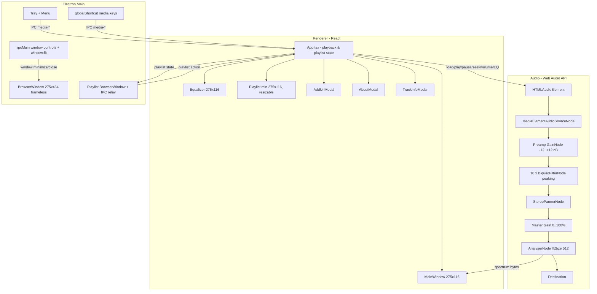

# ⚡ WinAMP Retro Player — Mimari ve Tasarım Belgesi

Bu belge projenin gerçek uygulamasını açıklar: React arayüzü, Web Audio ses zinciri, oynatma durumu akışı, Electron ana süreci ve CI/CD boru hattı.

---

## 1. Genel Bakış



Varsayılan olarak tek bir Electron penceresi vardır. Main, EQ ve Playlist "pencereleri" aynı React ağacında CSS ile çizilen panellerdir; ekstra başlık, araç çubuğu veya panel olmadan 275 px genişlikte dikey olarak 0 px boşlukla yığılırlar. Electron penceresi kenarlıksızdır (`frame: false`) ve `window:fit` ile panellerin toplam ölçüsüne kilitlenir, böylece panellerin altında/sağında boş arka plan kalmaz. Pencereyi taşımak için başlık çubukları `-webkit-app-region: drag` kullanır.

Playlist istenirse `↗` düğmesiyle ayrı bir kenarlıksız OS penceresine alınır ve serbestçe konumlandırılır; o durumda ana pencere yalnızca Main + EQ yüksekliğine küçülür. `↙` ile playlist ana pencereye geri yapışır. Manyetik kenetlenme / grup sürükleme motoru yoktur.

---

## 2. Oynatma Durumu ve Veri Akışı

### Durumun sahibi
Oynatma ile ilgili tüm görünür durum `src/App.tsx` içindeki `playback` state'idir:

| Alan | Açıklama |
| --- | --- |
| `isPlaying` / `isPaused` | UI bayrakları; motorun gerçek durumunu yansıtacak şekilde güncellenir |
| `currentTime` / `duration` | Gerçek medya olaylarından veya demo sayaçtan gelir |
| `volume` / `balance` | 0–100 ve -50..+50 |
| `shuffle` / `repeat` | Sıradaki parça seçimini ve playlist döngüsünü belirler |

`tracks`, `currentTrackIndex`, pencere görünürlükleri ve playlist boyutları da aynı bileşende tutulur. Klavye, Electron medya tuşları ve ses olayları eski closure'lara düşmesin diye güncel değerler `tracksRef`, `playbackRef`, `currentIndexRef` üzerinden okunur.

### Olay akışı
1. Kullanıcı bir parçaya çift tıklar → `startTrack(index)`.
2. `startTrack`, `AudioEngine.loadTrack(file | url | null)` çağırır ve `playback`'i sıfırlar.
3. Motor `play()` çağrısıyla gerçek medyayı veya demo synth'i başlatır.
4. Motor olayları React'e callback ile iletilir:
   - `timeupdate` → `currentTime`
   - `loadedmetadata` / `durationchange` → `duration` (playlist satırı da güncellenir)
   - `ended` → `handleTrackEnd()` (shuffle / repeat / sıradaki / dur)
   - `error` → kullanıcıya hata çubuğu
5. Demo parçalarda (dosya/URL yok) `ended` yerine 1 saniyelik sayaç çalışır ve süre dolunca aynı `handleTrackEnd()` çağrılır.

Manuel `Next`/`Previous` her zaman çalar; otomatik geçişte son parçadan sonra `repeat` kapalıysa oynatma durur.

### Playlist kaydırma çubuğu
Liste kaydırma alanı native scrollbar'ı gizler (`scrollbar-width: none` + `::-webkit-scrollbar { display: none }`), çünkü Chromium bazı platformlarda overlay scrollbar'a düşüp `::-webkit-scrollbar` temalamasını yok sayar. Bunun yerine `Playlist.tsx` içinde `.wa-scrollbar` / `.wa-scrollbar-thumb` çizilir: `scroll` olayı ve `ResizeObserver` thumb yüksekliğini/konumunu günceller; thumb sürükleme ve track'e tıklama `scrollTop`'u hesaplar. Görünüm `index.css` içindeki metal gradyan/bevel kurallarıyla Winamp pencereleriyle eşleşir.

---

## 3. Ses Motoru

`src/audio/AudioEngine.ts`, tek bir `AudioContext` ve tek bir `HTMLAudioElement` yönetir.

### Grafik
```
HTMLAudioElement
  → MediaElementAudioSourceNode
  → Preamp GainNode            (-12 dB … +12 dB, EQ kapalıyken 0 dB)
  → BiquadFilter × 10          (peaking, Q = 1.4)
  → StereoPannerNode           (-1 … +1)
  → Master GainNode            (0 … 1)
  → AnalyserNode               (fftSize 512, smoothing 0.75)
  → AudioContext.destination
```

### Bantlar
`60, 170, 310, 600, 1000, 3000, 6000, 12000, 14000, 16000 Hz` — hepsi `peaking`, kazanç -12…+12 dB. Varsayılan eğri: `[4, 2, -1, -3, 0, 3, 5, 4, 2, 1]`.

### Ayar kalıcılığı
Ses seviyesi, balance, preamp, bant kazançları ve EQ açık/kapalı durumu motor içinde saklanır. AudioContext yalnızca ilk kullanıcı etkileşiminde oluşturulduğu için, kullanıcı çalmadan önce EQ/volume değiştirse bile `initContext()` sonunda `applySettings()` tüm değerleri uygular. Equalizer bileşeni kapalıyken değerler kaybolmaz; yeniden açıldığında motorun son durumundan başlar.

### Medya yaşam döngüsü
- `loadTrack(file)`: önceki `blob:` URL iptal edilir (`URL.revokeObjectURL`), element sıfırlanır, yeni kaynak atanır.
- `loadTrack(null)`: kaynak temizlenir, demo synth moduna geçilir.
- `seek`: yalnızca gerçek kaynak varsa ve süre sonluysa uygulanır.
- `error`: desteklenmeyen format / bulunamayan dosya kullanıcıya bildirilir, UI "çalıyor" durumunda kalmaz.
- `play()` promise reddi (autoplay/cihaz hatası) yakalanır ve hata olarak raporlanır.

### Demo synth
Paketteki 6 parça gerçek medya içermez. Bu parçalar seçildiğinde `startDemoSynthBeat()` 180 ms'lik adımlarla akor + bas osilatörleri üretir; çıkış preamp/master zincirinden geçtiği için volume, EQ ve spectrum çalışır. Gerçek bir parçaya geçildiğinde synth durdurulur.

### Spektrum ve osiloskop
`AnalyserNode.getByteFrequencyData` ile 256 bayt okunur; ilk 64 bin 18 çubuğa eşlenir. Clutterbar'daki **V** düğmesi spectrum → osiloskop (`getByteTimeDomainData`) → kapalı arasında döner; kapalıyken tuval siyah kalır. Oynatma durduğunda veya görselleştirici kapalıyken animasyon döngüsü tamamen durur (boşuna 60 FPS çalışmaz), yalnızca tek bir statik kare çizilir.

---

## 4. Electron Katmanı

### `electron/main.js`
- **Tek örnek**: `app.requestSingleInstanceLock()`; ikinci örnek mevcut pencereyi öne getirir.
- **Pencere**: kenarlıksız (`frame: false`), 275×464 (Main 116 + EQ 116 + Playlist 232), `backgroundColor: '#0d0e10'`, `contextIsolation: true`, `nodeIntegration: false`, `webSecurity` varsayılan (açık). Başlık çubukları `-webkit-app-region: drag` ile pencereyi taşır; `.wa-tbtn` ve tıklanabilir başlık içerikleri `no-drag`.
- **Boşluksuz pencere (`window:fit`)**: renderer panellerin ölçüsünü `fitWindow(w, h)` ile bildirir; `applyContentSize` önce `setMaximumSize(10000, 10000)` ile sınırı açar (aksi halde küçülmüş pencere tekrar büyüyemez), sonra `setMinimumSize` + `setContentSize`, en son `setMaximumSize` ile min = max kilidi uygular. Böylece pencere her zaman panelleri tam sarar, kullanıcı elle boyutlandırıp boş arka plan oluşturamaz.
- **Ayrı playlist penceresi**: `playlist:detach` ikinci bir kenarlıksız `BrowserWindow` açar (`?panel=playlist`), ana pencerenin sağına yerleştirir, ekran çalışma alanına sıkıştırır. `playlist:attach` pencereyi kapatır; `playlist:close` da kapatır ama renderer'a "hide" nedeni bildirir. `playlist:visibility` PL düğmesiyle ayrı pencereyi gizler/gösterir.
- **State aktarımı**: ana pencere `playlist:state` gönderir, main process son durumu saklar ve ayrı pencereye iletir (`did-finish-load` sonrası da tekrar gönderir). Ayrı pencereden gelen `playlist:action` komutları (`select-track`, `remove-track`, `add-files`, `add-url`, oynatma komutları) ana pencereye yönlendirilir; dosyalar `ArrayBuffer` olarak taşınır çünkü `File` nesneleri IPC sınırını geçemez.
- **Geliştirme/production**: `VITE_DEV_SERVER_URL` varsa Vite sunucusu (`?panel=` sorgusuyla), yoksa `dist/index.html` (`loadFile` + `query`) yüklenir.
- **Tepsi**: ikon, oynat/durdur/sonraki/önceki, göster ve çıkış. Tepsi oluşturulamazsa uygulama pencere kapanınca normal şekilde çıkar.
- **Kapatma davranışı**: tepsi varsa pencere gizlenir (`close` engellenir); ayrı playlist de gizlenir. Tam çıkış tepsi menüsünden veya `before-quit` ile olur.
- **Global kısayollar**: `MediaPlayPause`, `MediaNextTrack`, `MediaPreviousTrack`, `MediaStop` bir kez kaydedilir, `will-quit`'te temizlenir.
- **IPC**: `window:minimize`, `window:close`, `window:always-on-top` (renderer'daki sahte başlık çubuğu ve clutterbar düğmeleri) + `window:fit` ve `playlist:*` kanalları.
- **İkon yolu**: geliştirmede `build/`, paketlenmiş uygulamada `process.resourcesPath` (electron-builder `extraResources` ile kopyalanır).
- DevTools yalnızca paketlenmemiş geliştirme derlemesinde açılabilir.

### Pencereyi panellere oturtan hook
`src/hooks/useFitElectronWindow.ts` hedef panelin ölçüsünü izler ve `fitWindow` çağırır. Üç ayrıntı kritiktir:

- `ResizeObserver` tek başına yetmez; pencere katlanınca (windowshade) yalnızca inline `style` değişir, bu yüzden `MutationObserver` (`style`/`class`, subtree) birincil tetikleyicidir.
- Zamanlama `queueMicrotask` ile yapılır. `requestAnimationFrame`, `ResizeObserver` teslimi ve `setTimeout` Chromium tarafından örtülmüş/arka plan pencerelerde duraklatılır veya kısılır; bu yüzden ayrı playlist odaktayken ana pencere eski boyutta kalabilirdi.
- Panel yığınında CSS geçişi (transition) kullanılmaz; animasyon sırasında `getBoundingClientRect` ara değer döndürüp pencereyi yanlış boyuta oturtur. `transitionend` yine de dinlenir.

### `electron/preload.js`
`contextBridge` ile yalnızca şunları açar:

| API | Açıklama |
| --- | --- |
| `onMediaPlayPause/Next/Prev/Stop(cb)` | Abonelik; her biri bir `unsubscribe` fonksiyonu döndürür |
| `minimizeWindow()` / `closeWindow()` | Pencere kontrolleri |
| `setAlwaysOnTop(enabled)` | Clutterbar **A** düğmesi; pencereyi (ve ayrı playlist'i) her zaman üstte tutar |
| `fitWindow(width, height)` | Pencereyi panellerin tam ölçüsüne oturtur |
| `notifyPlaylistState/requestPlaylistState/onPlaylistState` | Playlist durumunun ana pencere → ayrı pencere aktarımı |
| `sendPlaylistAction/onPlaylistAction` | Ayrı pencereden gelen seçim, silme, dosya ekleme ve oynatma komutları |
| `detachPlaylist/attachPlaylist/closePlaylistWindow/setPlaylistWindowVisible` | Ayrı playlist penceresini aç, ana pencereye yapıştır, kapat, gizle |
| `onPlaylistWindowClosed(reason)` | `attach` veya `hide` nedenini ana pencereye bildirir |
| `isElectron` | Ortam ayırt etmek için |

Renderer tarafındaki dinleyiciler `src/App.tsx` içinde bir kez kurulur ve unmount'ta temizlenir. Ayrı playlist giriş noktası `src/components/Playlist/DetachedPlaylist.tsx`'tir; `src/main.tsx` `?panel=playlist` sorgusuna göre yönlendirir.

---

## 5. Paketleme ve CI

`electron-builder.json`:
- `files`: `dist`, `electron`, `package.json`
- `extraResources`: `build/icon.ico` ve `build/icon.png` → uygulama kaynakları (tray/ikon için)
- Windows: NSIS + portable, macOS: dmg + zip (imzasız), Linux: AppImage + deb

`.github/workflows/build.yml`:
- `npm ci` (lockfile zorunlu) + npm cache
- `npm run build` (tip kontrolü + Vite)
- `electron-builder --win|--mac|--linux --publish never`
- Her platform artifact olarak yüklenir.
- `v*` etiketinde ayrı bir `release` işi tüm artifact'ları indirip tek GitHub Release oluşturur (paralel release yarışı yoktur).

---

## 6. Bilinen Mimari Sınırlar

- Pencereler tek BrowserWindow içinde çizilir; çoklu pencere, manyetik kenetlenme ve grup sürükleme yoktur. Yerleşim her zaman dikey yığındır.
- Kenarlıksız pencerede başlık çubuğu sürükleme bölgesi olduğu için çift tıklayla windowshade Electron'da çalışmaz; `▢` düğmesi kullanılır.
- `Ctrl+D` gerçek bir yeniden düzenleme değil, CSS `transform: scale(1.5)` uygular; Electron penceresi büyümez, içerik kaydırılır.
- Demo parçalar dosya içermediği için süreleri sabittir ve ses sentetiktir.
- macOS paketleri imzasız/notarize edilmemiştir.
- Electron 33 desteği sona ermiştir; güncel major sürüme geçiş planlanmaktadır.
