# 🏛️ WinAMP Retro Player - Mimari ve Tasarım Belgesi

Bu belge, **WinAMP 2.9x Retro Player** projesinin teknik altyapısını, pencere yönetim mekanizmasını, Web Audio API ses motorunu ve CI/CD derleme boru hattını açıklar.

---

## 1. Sistem Mimarisi

```mermaid
graph TD
    subgraph UI & Window Management
        Shell[App Container] --> WinMgr[Window Docking Manager]
        WinMgr --> MW[Main Player - Sabit 275x116]
        WinMgr --> EQ[Equalizer - Sabit 275x116]
        WinMgr --> PL[Playlist - Min 275x116 Resizable]
    end

    subgraph Audio Pipeline - Web Audio API
        Src[Audio File / Stream] --> Decoder[AudioContext Decoder]
        Decoder --> Preamp[Preamp GainNode -12dB..+12dB]
        Preamp --> FilterChain[10-Band BiquadFilter Chain]
        FilterChain --> MasterGain[Master Gain & Stereo Panner]
        MasterGain --> Analyser[AnalyserNode FFT & TimeDomain]
        Analyser --> Destination[Hardware Speakers]
        Analyser --> VisualizerCanvas[60 FPS Visualizer]
    end

    subgraph Packaging & OS Shell
        Electron[Electron Shell] --> NativeWin[Frameless Desktop Windows]
        NativeWin --> Tray[System Tray & Global Hotkeys]
    end
```



---

## 2. Pencere Yönetimi ve Manyetik Kenetlenme (Docking Engine)

### Boyutlandırma Kuralları
1. **Main Player**:
   - `width: 275px; height: 116px;`
   - Boyutlandırma tutamacı yoktur (`resize: none`).
2. **Equalizer**:
   - `width: 275px; height: 116px;`
   - Boyutlandırma tutamacı yoktur (`resize: none`).
3. **Playlist Window**:
   - `min-width: 275px; min-height: 116px;`
   - Sağ kenar, alt kenar ve sağ alt köşe tutamacından dinamik boyutlandırılabilir.

### 0 Piksel Kenetlenme ve Otomatik Zincirleme
- **Kenetlenme Toleransı**: Sürükleme esnasında pencereler birbirine 12 piksel yaklaştığında otomatik olarak bitişik koordinata yapışır (`snapDistance = 12`).
- **Bitişme Boşluğu**: Kenetlenen pencereler arasında tam `0px` boşluk kalır; 3D dış çerçeveler birleşir.
- **Otomatik Pozisyonlama**:
  - Dikey düzende `EQ` kapatıldığında (`visibility: false`), `Playlist` penceresi `y` ekseninde `116px` yukarı kayarak `Main Window`'un hemen altına yapışır.
  - `EQ` tekrar açıldığında `Playlist` `116px` aşağı itilerek `EQ`'nun altına yerleşir.
- **Grup Sürükleme (Drag Grouping)**: Ana pencere sürüklendiğinde, ona kenetlenmiş tüm pencereler (`EQ` ve `Playlist`) aynı delta (`dx, dy`) ile birlikte hareket eder.

---

## 3. Ses Motoru (Web Audio Pipeline)

### 10-Bant Filtre Frekansları ve Tipleri
Tüm bantlar `peaking` filtre türü kullanır:
| Bant No | Merkez Frekans | Filtre Tipi | Q Değeri | Kazanç Aralığı |
| :--- | :--- | :--- | :--- | :--- |
| **0** | 60 Hz | peaking | 1.4 | -12 dB ... +12 dB |
| **1** | 170 Hz | peaking | 1.4 | -12 dB ... +12 dB |
| **2** | 310 Hz | peaking | 1.4 | -12 dB ... +12 dB |
| **3** | 600 Hz | peaking | 1.4 | -12 dB ... +12 dB |
| **4** | 1 kHz | peaking | 1.4 | -12 dB ... +12 dB |
| **5** | 3 kHz | peaking | 1.4 | -12 dB ... +12 dB |
| **6** | 6 kHz | peaking | 1.4 | -12 dB ... +12 dB |
| **7** | 12 kHz | peaking | 1.4 | -12 dB ... +12 dB |
| **8** | 14 kHz | peaking | 1.4 | -12 dB ... +12 dB |
| **9** | 16 kHz | peaking | 1.4 | -12 dB ... +12 dB |

### Spektrum Analizörü (AnalyserNode)
- `fftSize`: 1024
- `smoothingTimeConstant`: 0.75
- 19 frekans aralığı logaritmik olarak ayrıştırılır ve tepe noktası yerçekimi simülasyonu (`peak gravity: 0.35 px/frame`) ile klasik düşen tepe noktaları oluşturulur.

---

## 4. GitHub Actions CI/CD Dağıtım Boru Hattı

`.github/workflows/build.yml` iş akışı, her etiket (`v*`) ve commit için 3 işletim sisteminde bağımsız sanal makineler ayağa kaldırır:

```yaml
name: Build Cross-Platform Releases

on:
  push:
    tags:
      - 'v*'
  workflow_dispatch:

jobs:
  build:
    strategy:
      matrix:
        os: [windows-latest, macos-latest, ubuntu-latest]
    runs-on: ${{ matrix.os }}

    steps:
      - uses: actions/checkout@v4
      - uses: actions/setup-node@v4
        with:
          node-version: 22
          cache: 'npm'

      - name: Install dependencies
        run: npm ci

      - name: Build frontend
        run: npm run build

      - name: Build and Package Electron App
        uses: samuelmeuli/action-electron-builder@v1
        with:
          github_token: ${{ secrets.GITHUB_TOKEN }}
          release: true
          args: --config electron-builder.json
```
