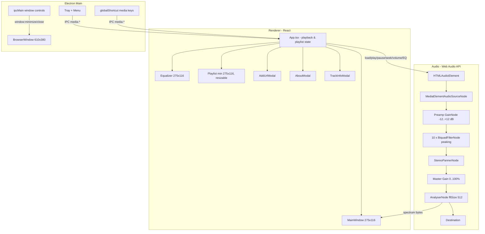

# ⚡ WinAMP Retro Player — Mimari ve Tasarım Belgesi

Bu belge projenin gerçek uygulamasını açıklar: React arayüzü, Web Audio ses zinciri, oynatma durumu akışı, Electron ana süreci ve CI/CD boru hattı.

---

## 1. Genel Bakış



Tek bir Electron penceresi vardır. Main, EQ ve Playlist "pencereleri" aynı React ağacında CSS ile çizilen panellerdir; ayrı OS pencereleri veya sürükleme/kenetlenme motoru yoktur.

---

## 2. Oynatma Durumu ve Veri Akışı

### Durumun sahibi
Oynatma ile ilgili tüm görünür durum `src/App.tsx` içindeki `playback` state'idir:

| Alan | Açıklama |
| --- | --- |
| `isPlaying` / `isPaused` | UI bayrakları; motorun gerçek durumunu yansıtacak şekilde güncellenir |
| `currentTime` / `duration` | Gerçek medya olaylarından veya demo sayaçtan gelir |
| `volume` / `balance` | 0–100 ve -50..+50 |
| `shuffle` / `repeat` | Sıradaki parça seçimini ve playlist döngüsünü belirler |

`tracks`, `currentTrackIndex`, `layoutMode`, pencere görünürlükleri ve playlist boyutları da aynı bileşende tutulur. Klavye, Electron medya tuşları ve ses olayları eski closure'lara düşmesin diye güncel değerler `tracksRef`, `playbackRef`, `currentIndexRef` üzerinden okunur.

### Olay akışı
1. Kullanıcı bir parçaya çift tıklar → `startTrack(index)`.
2. `startTrack`, `AudioEngine.loadTrack(file | url | null)` çağırır ve `playback`'i sıfırlar.
3. Motor `play()` çağrısıyla gerçek medyayı veya demo synth'i başlatır.
4. Motor olayları React'e callback ile iletilir:
   - `timeupdate` → `currentTime`
   - `loadedmetadata` / `durationchange` → `duration` (playlist satırı da güncellenir)
   - `ended` → `handleTrackEnd()` (shuffle / repeat / sıradaki / dur)
   - `error` → kullanıcıya hata çubuğu
5. Demo parçalarda (dosya/URL yok) `ended` yerine 1 saniyelik sayaç çalışır ve süre dolunca aynı `handleTrackEnd()` çağrılır.

Manuel `Next`/`Previous` her zaman çalar; otomatik geçişte son parçadan sonra `repeat` kapalıysa oynatma durur.

---

## 3. Ses Motoru

`src/audio/AudioEngine.ts`, tek bir `AudioContext` ve tek bir `HTMLAudioElement` yönetir.

### Grafik
```
HTMLAudioElement
  → MediaElementAudioSourceNode
  → Preamp GainNode            (-12 dB … +12 dB, EQ kapalıyken 0 dB)
  → BiquadFilter × 10          (peaking, Q = 1.4)
  → StereoPannerNode           (-1 … +1)
  → Master GainNode            (0 … 1)
  → AnalyserNode               (fftSize 512, smoothing 0.75)
  → AudioContext.destination
```

### Bantlar
`60, 170, 310, 600, 1000, 3000, 6000, 12000, 14000, 16000 Hz` — hepsi `peaking`, kazanç -12…+12 dB. Varsayılan eğri: `[4, 2, -1, -3, 0, 3, 5, 4, 2, 1]`.

### Ayar kalıcılığı
Ses seviyesi, balance, preamp, bant kazançları ve EQ açık/kapalı durumu motor içinde saklanır. AudioContext yalnızca ilk kullanıcı etkileşiminde oluşturulduğu için, kullanıcı çalmadan önce EQ/volume değiştirse bile `initContext()` sonunda `applySettings()` tüm değerleri uygular. Equalizer bileşeni kapalıyken değerler kaybolmaz; yeniden açıldığında motorun son durumundan başlar.

### Medya yaşam döngüsü
- `loadTrack(file)`: önceki `blob:` URL iptal edilir (`URL.revokeObjectURL`), element sıfırlanır, yeni kaynak atanır.
- `loadTrack(null)`: kaynak temizlenir, demo synth moduna geçilir.
- `seek`: yalnızca gerçek kaynak varsa ve süre sonluysa uygulanır.
- `error`: desteklenmeyen format / bulunamayan dosya kullanıcıya bildirilir, UI "çalıyor" durumunda kalmaz.
- `play()` promise reddi (autoplay/cihaz hatası) yakalanır ve hata olarak raporlanır.

### Demo synth
Paketteki 6 parça gerçek medya içermez. Bu parçalar seçildiğinde `startDemoSynthBeat()` 180 ms'lik adımlarla akor + bas osilatörleri üretir; çıkış preamp/master zincirinden geçtiği için volume, EQ ve spectrum çalışır. Gerçek bir parçaya geçildiğinde synth durdurulur.

### Spektrum ve osiloskop
`AnalyserNode.getByteFrequencyData` ile 256 bayt okunur; ilk 64 bin 18 çubuğa eşlenir. Clutterbar'daki **V** düğmesi spectrum → osiloskop (`getByteTimeDomainData`) → kapalı arasında döner; kapalıyken tuval siyah kalır. Oynatma durduğunda veya görselleştirici kapalıyken animasyon döngüsü tamamen durur (boşuna 60 FPS çalışmaz), yalnızca tek bir statik kare çizilir.

---

## 4. Electron Katmanı

### `electron/main.js`
- **Tek örnek**: `app.requestSingleInstanceLock()`; ikinci örnek mevcut pencereyi öne getirir.
- **Pencere**: 610×380, min 290×160, `contextIsolation: true`, `nodeIntegration: false`, `webSecurity` varsayılan (açık).
- **Geliştirme/production**: `VITE_DEV_SERVER_URL` varsa Vite sunucusu, yoksa `dist/index.html` yüklenir.
- **Tepsi**: ikon, oynat/durdur/sonraki/önceki, göster ve çıkış. Tepsi oluşturulamazsa uygulama pencere kapanınca normal şekilde çıkar.
- **Kapatma davranışı**: tepsi varsa pencere gizlenir (`close` engellenir); tam çıkış tepsi menüsünden veya `before-quit` ile olur.
- **Global kısayollar**: `MediaPlayPause`, `MediaNextTrack`, `MediaPreviousTrack`, `MediaStop` bir kez kaydedilir, `will-quit`'te temizlenir.
- **IPC**: `window:minimize`, `window:close`, `window:always-on-top` (renderer'daki sahte başlık çubuğu ve clutterbar düğmeleri).
- **İkon yolu**: geliştirmede `build/`, paketlenmiş uygulamada `process.resourcesPath` (electron-builder `extraResources` ile kopyalanır).
- DevTools yalnızca paketlenmemiş geliştirme derlemesinde açılabilir.

### `electron/preload.js`
`contextBridge` ile yalnızca şunları açar:

| API | Açıklama |
| --- | --- |
| `onMediaPlayPause/Next/Prev/Stop(cb)` | Abonelik; her biri bir `unsubscribe` fonksiyonu döndürür |
| `minimizeWindow()` / `closeWindow()` | Pencere kontrolleri |
| `setAlwaysOnTop(enabled)` | Clutterbar **A** düğmesi; pencereyi her zaman üstte tutar |
| `isElectron` | Ortam ayırt etmek için |

Renderer tarafındaki dinleyiciler `src/App.tsx` içinde bir kez kurulur ve unmount'ta temizlenir.

---

## 5. Paketleme ve CI

`electron-builder.json`:
- `files`: `dist`, `electron`, `package.json`
- `extraResources`: `build/icon.ico` ve `build/icon.png` → uygulama kaynakları (tray/ikon için)
- Windows: NSIS + portable, macOS: dmg + zip (imzasız), Linux: AppImage + deb

`.github/workflows/build.yml`:
- `npm ci` (lockfile zorunlu) + npm cache
- `npm run build` (tip kontrolü + Vite)
- `electron-builder --win|--mac|--linux --publish never`
- Her platform artifact olarak yüklenir.
- `v*` etiketinde ayrı bir `release` işi tüm artifact'ları indirip tek GitHub Release oluşturur (paralel release yarışı yoktur).

---

## 6. Bilinen Mimari Sınırlar

- Pencereler tek BrowserWindow içinde çizilir; çoklu pencere, manyetik kenetlenme ve grup sürükleme yoktur.
- `Ctrl+D` gerçek bir yeniden düzenleme değil, CSS `transform: scale(1.5)` uygular; Electron penceresi büyümez.
- Playlist yüksekliği yan yana düzende EQ görünürlüğüne göre otomatik ayarlanır, kullanıcı resize'ı bu modda temel yüksekliğe dönebilir.
- Demo parçalar dosya içermediği için süreleri sabittir ve ses sentetiktir.
- macOS paketleri imzasız/notarize edilmemiştir.
- Electron 33 desteği sona ermiştir; güncel major sürüme geçiş planlanmaktadır.
